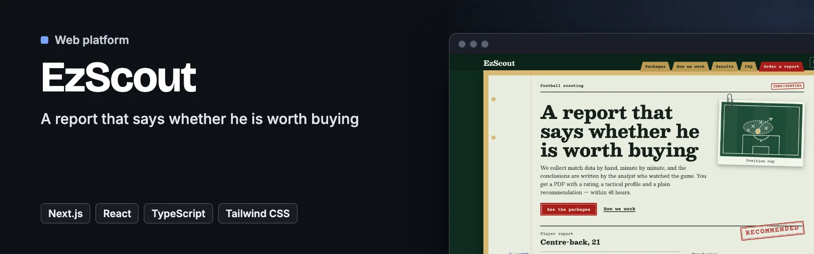
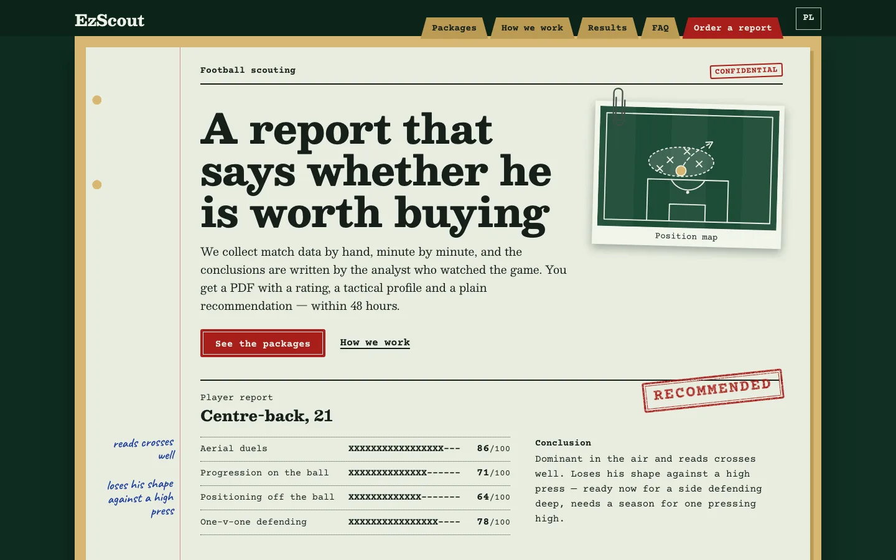
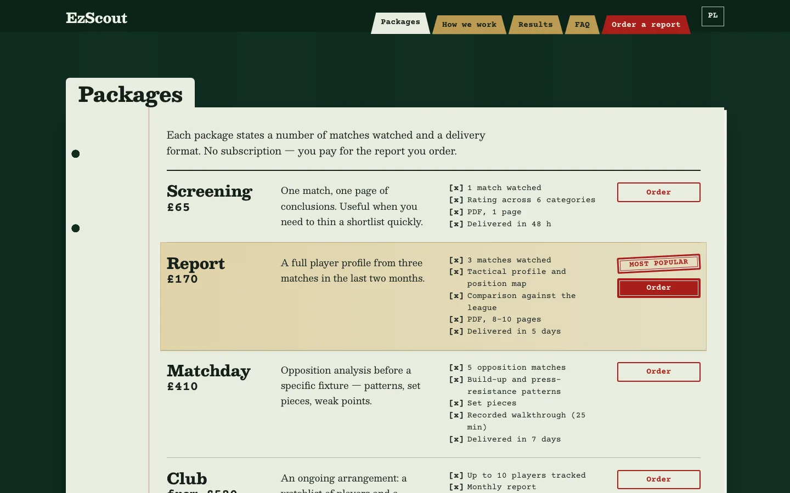
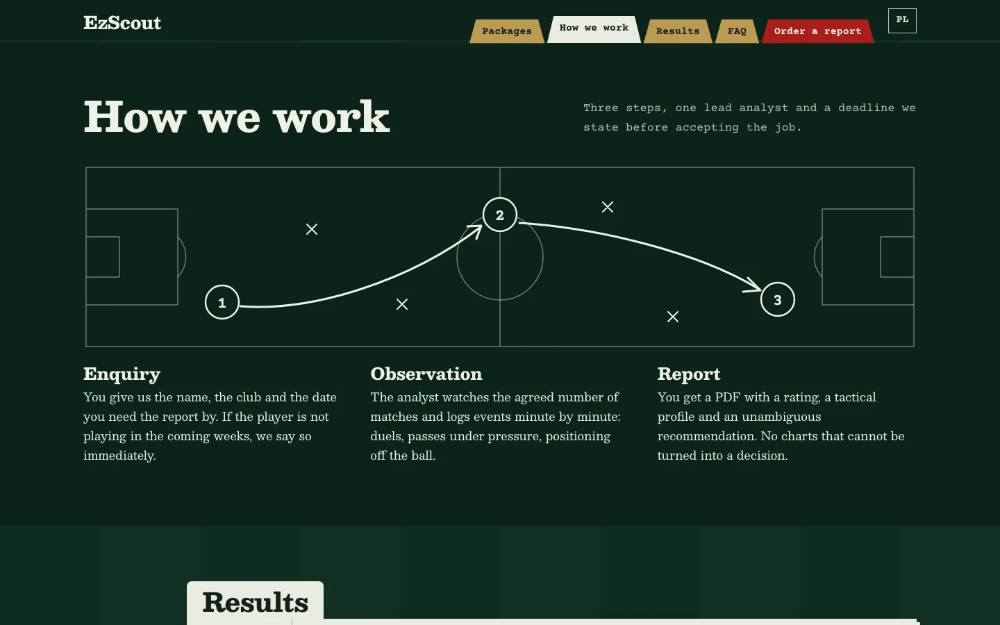
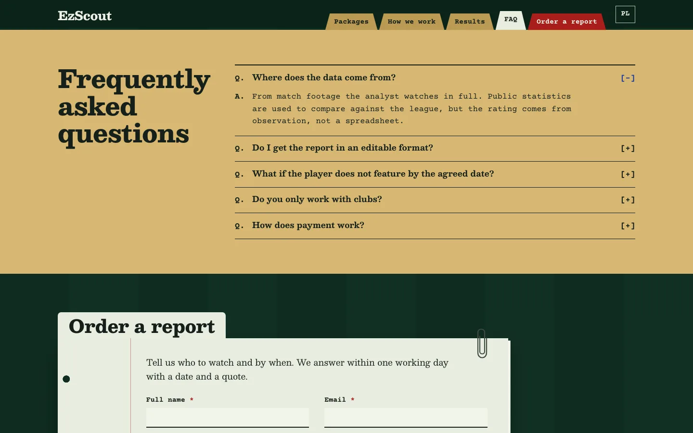

<p align="center">
  <a href="https://ezscout.dawidolko.pl/"></a>
</p>

# EzScout

> ⚽ **A report that says whether he is worth buying** — scouting reports and match analysis written by an analyst who watched the match, not generated from a stats feed

**EzScout** is a product site for a football scouting service: packages, process, results and an enquiry form. The premise is deliberately narrow — data collected by hand, minute by minute, and conclusions written by the person who did the watching. Every section on the page exists to support that one claim.

There is no backend and no database. The whole site is prerendered to files and served by GitHub Pages; the only interactive parts — the mobile menu and the enquiry form — run in the browser.

[](https://github.com/dawidolko/EzScout-Platform-NextJS/actions/workflows/deploy.yml)


**[Live site](https://ezscout.dawidolko.pl/)** · [Screenshots](#️-screenshots) · [Getting started](#-getting-started)

---

## 🎯 Key Features

- **Four packages** — from a single-match screening to a monthly retainer, each with a stated number of matches watched and a stated delivery time.
- **The hero is an open report** — the headline, a pinned position map, a typed rating sheet, the analyst's margin notes and a stamped verdict sit on one page, so the visitor sees what they are buying before reading a word of the offer.
- **Packages as a price ledger** — one ruled row per package, with matches watched and delivery time stated in each.
- **Honest results section** — the copy commits to publishing the misses alongside the hits, because a scouting service without misses is not credible.
- **CSS-only FAQ** — `<details>` and `<summary>`, no JavaScript, works with the script disabled.
- **Form that admits what it is** — validation runs in the browser and says plainly that nothing is sent. A demo that pretends to mail is worse than one that does not.

---

## 🖼️ Screenshots

| Hero — the offer in one screen                                                                  | Packages                                                                        |
| ------------------------------------------------------------------------------------------------ | --------------------------------------------------------------------------------- |
|                 |         |

| How the service works                                                             | Frequently asked questions                                              |
| ----------------------------------------------------------------------------------- | -------------------------------------------------------------------------- |
|  |  |

---

## 🧩 Application Layer

| Layer            | Responsibility                                                                              |
| ---------------- | ------------------------------------------------------------------------------------------- |
| `src/app`        | Routing, document metadata, fonts, JSON-LD and the 404 page. Two language routes, fully prerendered. |
| `src/components` | The page, header, footer and enquiry form. Only the header and the form run in the browser. |
| `src/components/tresc.ts` | All copy in both languages: packages, process steps, figures and FAQ entries. Editing the offer never means editing markup. |
| `src/components/Drawings.tsx` | The inline SVG line drawings: position map, tactical move, paper clip and centre circle. |
| `src/app/globals.css`    | Design tokens and every material on the page. Components use named classes and read tokens from here. |

---

## 🛠️ Technology Stack

### Frontend

| Technology   | Version | Role                                            |
| ------------ | ------- | ----------------------------------------------- |
| Next.js      | 16      | App Router with `output: 'export'`               |
| React        | 19      | Component model                                  |
| TypeScript   | 5       | Strict mode, no implicit `any`                   |
| Tailwind CSS | 4       | Utility layer on top of a token theme            |

### Infrastructure

| Technology     | Role                                             |
| -------------- | ------------------------------------------------ |
| GitHub Actions | Typecheck, build and export verification         |
| GitHub Pages   | Static hosting behind a custom domain            |

---

## 🚀 Getting Started

### Prerequisites

- Node.js 20 or newer
- npm 10 or newer

### 1. Clone the Repository

```bash
git clone https://github.com/dawidolko/EzScout-Platform-NextJS.git
cd EzScout-Platform-NextJS
```

### 2. Install Dependencies

```bash
npm install
```

### 3. Run

```bash
npm run dev        # http://localhost:3000
npm run verify     # typecheck + production build
npm run serve      # serve the exported site from out/
```

---

## 🎨 Design

A confidential scouting file lying open on a mown pitch. Every surface is a material with a job, and the page is read as a sequence of documents rather than a stack of sections.

| Material    | Colour    | Used for                                                                   |
| ----------- | --------- | -------------------------------------------------------------------------- |
| Grass       | `#0f2c20` | The desk everything lies on, with faint mowing stripes                     |
| Sage paper  | `#e8ede0` | Report sheets, with a ruled margin and punched binder holes                |
| Kraft       | `#d8b872` | The folder, the index tabs and the FAQ divider                             |
| Chalk       | `#edf1e6` | Tactical line drawings and text on the grass                               |
| Stamp ink   | `#a81e1a` | Verdicts and the actions that place an order                               |
| Blue biro   | `#1b3a9c` | The analyst's handwritten margin notes                                     |

- **Header:** index tabs standing on the rim of the folder. The tab of the section in view comes forward.
- **Hero:** one open report page, not a text and card split. The rating scale is typed, one `X` per five points.
- **Sections:** a price ledger, a chalk tactics board drawn on the grass, a season review typed as a record, a kraft Q and A transcript and a printed order form.
- **Type:** [Besley](https://github.com/indestructible-type/Besley) for the voice of the service, [Courier Prime](https://github.com/quoteunquoteapps/CourierPrime) for anything typed into a record and [Caveat](https://github.com/googlefonts/caveat) for margin notes only. All three are self-hosted woff2 subsets with Polish coverage in `src/app/fonts`; Caveat is not preloaded.
- **Motion:** one unprompted moment, the verdict stamp landing after the page loads. The chalk line of the tactics board draws as it scrolls into view. Both are off with reduced motion, and the resting state is the finished drawing.

Colours live as custom properties in `src/app/globals.css`, defined once. The accessibility panel uses `#17583c` as its accent.

---

## ♿ Accessibility

- One `<h1>` per page, no skipped heading levels.
- Skip link as the first focusable element, `<main id="main-content">` as its target.
- `:focus-visible` rings set per material: chalk on the grass, blue biro on paper and kraft.
- Form errors bound with `aria-describedby` and `aria-invalid`; the message is text, never colour alone.
- The submitted-state message is announced through `aria-live`.
- `prefers-reduced-motion` honoured across every transition.

An accessibility panel in the corner of every page changes text size, contrast, font and motion, and remembers the choice on the device. It sits on top of the markup and does not replace accessible markup.

---

## 📁 Project Structure

```
src/
├── app/
│   ├── (en)/             English route with its metadata and JSON-LD
│   ├── (pl)/             Polish route with its metadata and JSON-LD
│   ├── fonts/            self-hosted woff2 subsets and their licence
│   ├── fonts.ts          font declarations
│   ├── csp.ts            Content Security Policy
│   ├── global-not-found.tsx
│   └── globals.css       design tokens and materials
└── components/
    ├── tresc.ts          all copy in both languages
    ├── StronaGlowna.tsx  every section of the page
    ├── Drawings.tsx      inline SVG line drawings
    ├── SiteHeader.tsx    index tabs and the phone menu
    ├── SiteFooter.tsx
    └── FormularzKontaktu.tsx
```

---

## 📄 License

MIT — see [LICENSE](LICENSE).

---

## 👨‍💻 Author

**Dawid Olko** · Fullstack / AI Developer

[Portfolio](https://olkodawid.dawidolko.pl) · [CV](https://cv.dawidolko.pl) · [LinkedIn](https://www.linkedin.com/in/dawidolko/) · [GitHub](https://github.com/dawidolko)
